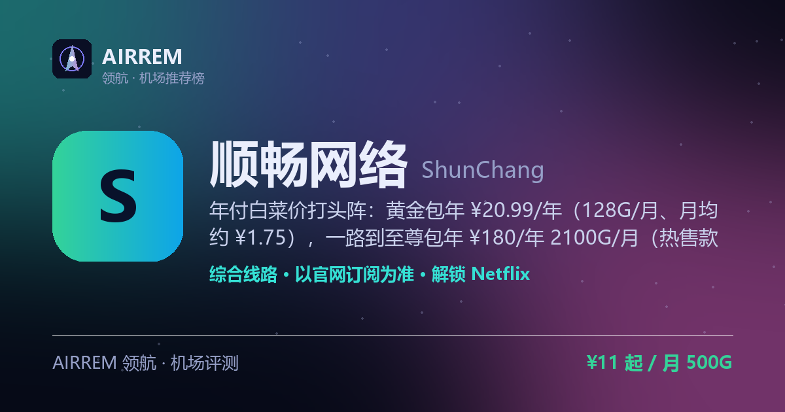

# 顺畅网络机场怎么样？2026 实测：年付白菜价 · 计费最全

> **顺畅网络** 适合谁？预算有限、想要超低价年付或按量买断，计费方式随便挑的日常科学上网用户。年付白菜价打头阵：黄金包年 ¥20.99/年（128G/月、月均约 ¥1.75），一路到至尊包年 ¥180/年 2100G/月（热售款）；月付 ¥11/500G 起、按量『不限时流量』300G ¥15.99 起买断、上到 ¥900/月专线定制——月付/季付/半年/年付 + 按量不限时 + 专线定制十几档任选，全档标称无限速带宽、32 个国家/地区节点、多设备同时在线

👉 **[顺畅网络 官网注册入口](https://t.rtxk.us/t/k2pajrb)** ｜ [完整评测与横向对比](https://555736.xyz/shunchang/)

---

## 我们的结论

顺畅网络（scl168 系列站点，官网自称『顺畅加速』）主打『计费档位全站最全 + 年付白菜价』：一边是白菜级整年年付——黄金包年 ¥20.99/年（128G/月、月均约 ¥1.75）、白金 ¥39.99/年 380G、钻石 ¥88/年 660G、大师 ¥130.99/年 1100G、至尊 ¥180/年 2100G（热售款）；一边是月付（¥11/500G 起，另有季付 ¥32、半年 ¥66、年付 ¥80）、按量一次性不限时买断（300G ¥15.99 到 5000G ¥130）乃至 ¥900/月专线定制，十几档任意挑，全档标称无限速带宽、32 个国家/地区节点、多设备同时在线。注意它线路类型与协议官网未在未登录页公开、第三方评测与社区口碑基本空白，且 scl168.club 下有多个同名域名，属低知名度新站，务必认准官方地址、先小额月付验证晚高峰与解锁，再考虑年付/买断。

## 基本信息

| 项目 | 内容 |
| --- | --- |
| 机场名称 | 顺畅网络（顺畅加速 · Smooth Network） |
| 成立时间 |  |
| 线路类型 | 线路类型官网未公开（另有 ¥900/月 专线定制档） |
| 支持协议 | 以官网订阅为准 |
| 流媒体解锁 | Netflix / Disney+ / YouTube |
| 节点地区 | 32 个国家/地区节点、30+ 高速节点（官网未点名具体城市，登录后查节点） |
| 计费方式 | 月付 / 季付 / 半年 / 年付 + 按量不限时买断（另有专线定制） |
| 起步价格 | ¥11 / 月 500G |
| 推荐场景 | 预算有限、想要超低价年付或按量买断，计费方式随便挑的日常科学上网用户 |

## 顺畅网络 套餐价格

| 套餐 | 价格 | 说明 |
| --- | --- | --- |
| 测试（月付） | ¥10 | 月付 · 每月 128G · 不限设备 · 入门试用 |
| 基础包月 | ¥11 | 月付 · 每月 500G · 无限速 · 30+ 节点（另有季付 ¥32 / 半年 ¥66 / 年付 ¥80） |
| 标准包月 | ¥16 | 月付 · 每月 1000G · 无限速 · 多设备同时在线 |
| 进阶包月 | ¥25 | 月付 · 每月 2000G · 无限速 · 多设备同时在线 |
| 黄金包年 | ¥20.99 | 年付 · 每月 128G 每月重置 · 无限速 · 月均约 ¥1.75 |
| 白金包年 | ¥39.99 | 年付 · 每月 380G 每月重置 · 无限速 |
| 钻石包年 | ¥88 | 年付 · 每月 660G 每月重置 · 无限速 |
| 大师包年 | ¥130.99 | 年付 · 每月 1100G 每月重置 · 无限速 |
| 至尊包年（热售款） | ¥180 | 年付 · 每月 2100G 每月重置 · 无限速 |
| 不限时 300G | ¥15.99 | 一次性买断 · 300G 用完为止 · 无限速 · 多设备 |
| 不限时 1200G（推荐） | ¥36 | 一次性买断 · 1200G 用完为止 · 无限速 · 多设备 |
| 不限时 5000G | ¥130 | 一次性买断 · 5000G 用完为止 · 无限速 · 多设备 |
| 专线定制 | ¥900 | 月付 · 专线定制 · 无限时 9999G · 高稳定档 |

> 周期订阅（月付 / 季付 / 半年 / 年付）按周期重置流量：基础包月 ¥11/月（500G），另有季付 ¥32、半年 ¥66、年付 ¥80；『包年套餐』为整年一次性年付、每月按额度重置（黄金 ¥20.99/128G 到至尊 ¥180/2100G，热售款）。『按量付费』为一次性不限时买断、用完为止（300G ¥15.99 到 5000G ¥130）。¥900/月专线定制为无限时 9999G 档。全档标称无限速带宽、32 个国家/地区节点、多设备同时在线（测试档标注不限设备）；线路类型与协议官网未在未登录页公开、以登录后订阅为准，价格以官网实时为准。

## 顺畅网络 是什么

顺畅网络是一家中文面板的付费机场，官网自称『顺畅加速』，站点挂在 scl168.club 域名下，走『平价口粮 + 计费灵活』路线，主打日常科学上网与多设备共享。

最有辨识度的是它的计费结构：月付、季付、半年、年付、按量『不限时流量』一次性买断，甚至 ¥900/月的专线定制档一应俱全，十几个价位任意挑；其中年付特别便宜——黄金包年 ¥20.99/年（128G/月）月均不到两块钱。

## 套餐与计费

顺畅网络分『周期订阅』与『按量付费』两大类。周期订阅里，月付有测试 ¥10/128G、基础 ¥11/500G、标准 ¥16/1000G、进阶 ¥25/2000G（基础档另有季付 ¥32、半年 ¥66、年付 ¥80）；整年『包年套餐』从黄金 ¥20.99/年（128G/月）、白金 ¥39.99/年（380G/月）、钻石 ¥88/年（660G/月）、大师 ¥130.99/年（1100G/月）到至尊 ¥180/年（2100G/月，热售款），越贵档每月额度越大。

按量付费为一次性『不限时流量』买断、用完为止：300G ¥15.99、600G ¥26、1200G ¥36（官网标推荐）、2500G ¥75、5000G ¥130，适合低频或长期备用。顶部还有 ¥900/月的专线定制档（无限时 9999G）。

- 周期订阅：月付 / 季付 / 半年 / 年付，按周期重置流量
- 包年套餐：黄金 ¥20.99/年（月均约 ¥1.75）到至尊 ¥180/年（2100G/月）
- 按量付费：一次性不限时买断 300G ¥15.99 到 5000G ¥130，用完为止

> 💡 官网首页仅展示套餐名与流量/设备/带宽等基础特点，具体线路、节点与解锁清单需登录后在面板查看；价格以官网实时为准。

## 线路与节点

官网标称覆盖 32 个国家/地区节点、30+ 高速节点，全档『无限速带宽』、多设备同时在线（测试档标注不限设备）。除常规套餐外另设 ¥900/月的『专线定制』档（无限时 9999G），面向对稳定性要求更高的用户。

不过官网未在未登录页披露具体城市、线路类型（直连 / 中转 / 专线）与承载协议，除专线定制档明确为专线外，其余档位线路以登录后订阅为准，缺乏第三方实测数据。

> 💡 『无限速』『32 国节点』为官网宣传口径，晚高峰真实表现请以自身线路小额验证为准。

## 解锁与客户端

官网首页未明列流媒体解锁清单，一般 32 国节点的机场可覆盖 Netflix、Disney+、YouTube 等常见平台，但具体解锁能力（含 ChatGPT、港剧 / 日漫等）请以登录后订阅与自身实测为准，不要只看宣传。

协议官网同样未在未登录页公开；导入时建议使用 mihomo 内核客户端（Clash Verge / FlClash 等）或 iOS 的 Shadowrocket、Karing，以兼容较新协议。

## 优点与缺点

**✅ 优点**

- 计费档位全站最全：月付 / 季付 / 半年 / 年付 + 按量一次性不限时买断 + 专线定制，十几档任意挑
- 年付白菜价：黄金包年 ¥20.99/年（128G/月、月均约 ¥1.75）起，至尊 ¥180/年直接给到 2100G/月
- 全档标称无限速带宽、32 个国家/地区节点，多设备同时在线
- 按量『不限时流量』一次性买断（300G ¥15.99 到 5000G ¥130），适合低频或长期备用

**⚠️ 缺点**

- 线路类型与协议官网未在未登录页公开，解锁清单也需登录后 / 实测确认
- 第三方实测与晚高峰数据基本空白，属低知名度新站
- scl168.club 下有多个同名『顺畅网络』域名，需认准官方地址进入，防山寨
- 机场行业有跑路风险，建议先小额月付验证，别一上来就大额年付 / 买断

## 适合谁 / 不适合谁

| 👍 适合 | 👎 不适合 |
| --- | --- |
| 预算敏感、想要超低价年付（月均一两块）长期挂机的用户 | 只信老牌、要长期第三方实测口碑的用户 |
| 计费需求多变、想在月付 / 年付 / 按量买断间自由挑档的用户 | 追求 IEPL/IPLC 全专线、要明确线路与解锁清单的重度用户 |
| 多设备同时在线、要不限速带宽做日常科学上网的用户 |  |

## 常见问题

**Q：顺畅网络的年付真有这么便宜吗？**

A：黄金包年 ¥20.99/年对应每月 128G、月均约 ¥1.75，往上白金 ¥39.99/年（380G/月）、钻石 ¥88/年（660G/月）、大师 ¥130.99/年（1100G/月）、至尊 ¥180/年（2100G/月）逐档加量。年付为整年一次性预付、每月按额度重置，越是低价档越建议先用月付（基础 ¥11/500G）验证晚高峰与解锁，再考虑上年付。

**Q：顺畅网络是专线还是中转？用什么协议？**

A：官网未在未登录页公开线路类型与协议，只有『专线定制』档（¥900/月）明确为专线，其余月付 / 年付 / 按量档的线路与承载协议以登录后订阅为准。导入建议用 mihomo 内核客户端（Clash Verge / FlClash）或 iOS 的 Shadowrocket / Karing 以兼容较新协议。

**Q：scl168 下好几个『顺畅网络』，怎么认准官方、防山寨？**

A：该品牌在 scl168.club 下有多个子域名，请通过本站推荐链接进入官方站注册，别在搜索引擎随手点同名站，避免买到山寨 / 钓鱼站；同时先小额月付验证，再决定是否年付 / 买断。

## 同类机场推荐

拿不定主意？可以再看看这几家同类型的：

- **[Tifa](https://555736.xyz/tifa/)** — 不限设备 · 平价口粮，¥20 起
- **[Mitce](https://555736.xyz/mitce/)** — 性价比 / 新手主推，¥4 起
- **[西部数据](https://555736.xyz/westdata/)** — 稳定专线党，¥17 起

全部 38 家机场的横向对比与选购方法论：**[信号塔 SignalTower · 机场大全](https://555736.xyz/airports/)**

---

数据更新：2026-07 ｜ 价格、套餐与优惠码以官网实时为准 ｜ 本仓库为第三方评测整理，与 顺畅网络 官方无隶属关系 ｜ 请遵守当地法律法规使用网络服务。

关键词：顺畅网络、顺畅网络机场、顺畅网络怎么样、顺畅网络靠谱吗、顺畅网络评测、顺畅网络官网、顺畅网络优惠码、顺畅网络注册、顺畅网络跑路、顺畅加速、ShunChang、scl168、年付白菜价机场、便宜年付机场、按量不限时机场、一次性流量包、不限速机场、多设备机场、专线定制、机场推荐、机场评测、科学上网、翻墙机场、Clash订阅、Netflix解锁、ChatGPT机场
